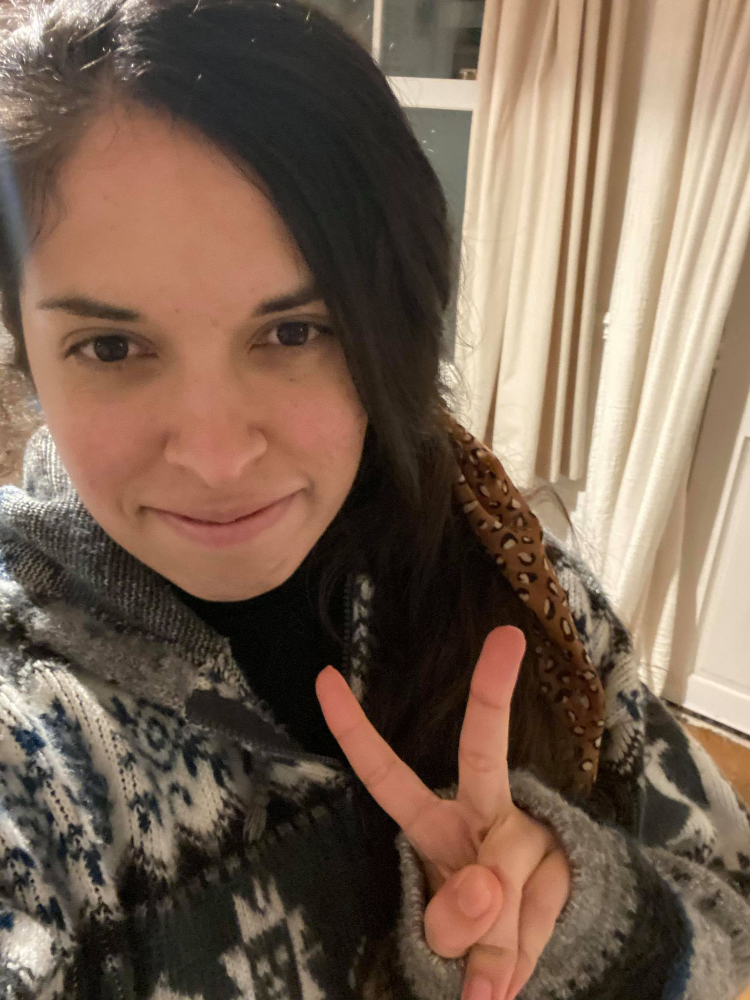

# Tamara Fernández

## About me

I am an **Assistant Professor** at the Faculty of Engineering and Sciences, Universidad Adolfo Ibáñez, Viña del Mar, Chile.

Previously, I was a Postdoctoral Research Fellow at the [Gatsby Computational Neuroscience Unit](https://www.ucl.ac.uk/gatsby/), University College London, where I worked with Arthur Gretton. I joined the Gatsby Unit as a [Biometrika Postdoctoral Research Fellow](http://biometrika.wikidot.com/) in 2017.

I obtained my **DPhil in Statistics from the University of Oxford** in 2018, under the supervision of Yee Whye Teh.

My research focuses on statistical methodology and machine learning, particularly **non-parametric statistics, kernel methods, survival analysis, and inference for complex data**. I am also interested in interdisciplinary applications of statistical and machine learning methods.

 

### Research interests

* Non-parametric statistics
* Kernel methods and reproducing kernel Hilbert spaces
* Statistical machine learning
* Survival analysis
* Hypothesis testing
* Bayesian non-parametrics

### Links

* [Curriculum Vitae (PDF)](CV_Tamara_Fernandez.pdf)
* Email: tamara.fernandez at uai dot cl

---

## Recent and ongoing research

My recent research focuses on kernel-based statistical inference, including goodness-of-fit and independence testing, survival analysis, multiple testing, and methods for structured and complex data.

### Work in progress

* **A Multiple Kernel Testing Procedure for Non-Proportional Hazards in Factorial Designs**
  with Marc Ditzhaus and Nicolás Rivera.
  [(preprint)](https://arxiv.org/abs/2206.07239)

* **Kernel Tests for Martingales**
  with Merle Munko and Nicolás Rivera.

* **A Kernel Test for the Proportional Hazards Assumption**
  with Merle Munko and Nicolás Rivera.

* **Clustering Point Processes through Distributional Representations**
  with Nicolás Rivera, Tomás Sanhueza and Wenkai Xu.

### Under review

* **A Kernelized Approach to Multiple Contrast Testing in General Multivariate Factorial Designs**
  with Nicolás Rivera.
  Second-round revision at the *Journal of Multivariate Analysis*.

---

## Publications

### Journal articles

1. **Composite Goodness-of-fit Tests with Kernels.**
   with Oscar Key, Arthur Gretton and François-Xavier Briol.
   *Journal of Machine Learning Research*, 26(51):1–60, 2025.
   [(paper)](https://www.jmlr.org/papers/v26/24-0276.html)

2. **A General Framework for the Analysis of Kernel-based Tests.**
   with Nicolás Rivera.
   *Journal of Machine Learning Research*, 25(95):1–40, 2024.
   [(paper)](https://jmlr.org/papers/v25/23-0985.html)

3. **A Kernel Log-Rank Test of Independence for Right-Censored Data.**
   with Arthur Gretton, David Rindt and Dino Sejdinovic.
   *Journal of the American Statistical Association*, 118(542):925–936, 2023.
   [(paper)](https://www.tandfonline.com/doi/abs/10.1080/01621459.2021.1961784)
   [(arXiv)](https://arxiv.org/abs/1912.03784)

4. **A Reproducing Kernel Hilbert Space Log-Rank Test for the Two-Sample Problem.**
   with Nicolás Rivera.
   *Scandinavian Journal of Statistics*, 48(4):1384–1432, 2021.
   [(paper)](https://onlinelibrary.wiley.com/doi/abs/10.1111/sjos.12496)

5. **Kaplan–Meier V- and U-statistics.**
   with Nicolás Rivera.
   *Electronic Journal of Statistics*, 14:1872–1916, 2020.
   [(paper)](https://projecteuclid.org/euclid.ejs/1587693634)

### Conference publications

1. **A Kernel Test for Quasi-Independence.**
   with Wenkai Xu, Marc Ditzhaus and Arthur Gretton.
   *Advances in Neural Information Processing Systems (NeurIPS)*, 2020.
   [(paper)](https://proceedings.neurips.cc/paper/2020/hash/aeefb050911334869a7a5d9e4d0e1689-Abstract.html)

2. **Kernelized Stein Discrepancy Tests of Goodness-of-Fit for Time-to-Event Data.**
   with Nicolás Rivera, Wenkai Xu and Arthur Gretton.
   *International Conference on Machine Learning (ICML)*, 2020.
   [(paper)](https://proceedings.mlr.press/v119/fernandez20a.html)

3. **A Maximum-Mean-Discrepancy Goodness-of-Fit Test for Censored Data.**
   with Arthur Gretton.
   *International Conference on Artificial Intelligence and Statistics (AISTATS)*, 2019.
   [(paper)](http://proceedings.mlr.press/v89/fernandez19a/fernandez19a.pdf)

4. **Gaussian Processes for Survival Analysis.**
   with Nicolás Rivera and Yee Whye Teh.
   *Advances in Neural Information Processing Systems (NeurIPS)*, 2016.
   [(paper)](https://papers.nips.cc/paper/6443-gaussian-processes-for-survival-analysis.pdf)

### Technical reports

1. **Posterior Consistency for a Non-Parametric Survival Model under a Gaussian Process Prior.**
   with Yee Whye Teh.
   [(arXiv)](https://arxiv.org/abs/1611.02335)

---

## Research projects

### SENTINET

**Principal Investigator**, Advanced Data Analytics and Modeling Research Core, 2026–2031.

*SENTINET: Surveillance, Epidemiology, and New Technologies for Infectious Emerging Threats.*

National Research Center of Interest, project CIN250062.

### ECOS-ANID

**Director**, 2025–2027.

*Building Bridges between Reliability Theory and Survival Analysis: A Kernel Method Approach.*

Project ECOS240043.

### Fondecyt Iniciación

**Principal Investigator**, 2022–2026.

*Kernelised Linear Tests: Combining Statistics and Machine Learning to Boost Test Power.*

Project 11221143.

### IDeA Investigación Tecnológica

**Alternate Director**, 2024–2026.

*Intrusion.aware: Plataforma integral para detectar y responder ciberataques usando inteligencia artificial responsable.*

Project IT24I0144.

### CMM Collaboration

**New Statistical Distances in Time-Series Analysis**, 2024.

CMM counterpart: Felipe Tobar.

### MATH-AmSud

**Junior Investigator**, 2023–2024.

*Modeling and Estimating Massive Point Referenced Spatial Data.*

---

## Teaching

At Universidad Adolfo Ibáñez, I have taught undergraduate and graduate courses including:

* Probability and Statistics
* Foundations of Data Science
* Linear Algebra
* Kernel Methods for Machine Learning
* Modern Statistical Learning for Data Science

Previously, I was a Teaching Assistant at the University of Oxford for courses including Probability, Statistics, Modern Survival Analysis, and Advanced Simulation.

---

## Graduate student supervision

### PhD

* **Francisca Molina** — PhD in Data Science, Universidad Adolfo Ibáñez.
  Ongoing. Co-supervised with Javiera Barrera.

### Master's theses

* **Benjamín Urrutia** — MSc in Data Science, Universidad Adolfo Ibáñez.
  Ongoing.

* **Tomás Sanhueza Cabrera** — MSc in Data Science, Universidad Adolfo Ibáñez, 2024–2026.
  *Clustering Methods for Point Processes with Applications to Neuron Detection.*

* **Fernanda Mora Muñoz** — MSc in Data Science, Universidad Adolfo Ibáñez, 2023–2024.
  *Development of Algorithms Based on Maximum Mean Discrepancy for Efficient Multiple Hypothesis Testing.*

* **Nicolás Vidal Mancilla** — MSc in Data Science, Universidad Adolfo Ibáñez, 2022.
  *Independence Testing with Kernel Methods.*

---

## Selected honours and fellowships

* **Teaching Recognition Diploma**, Universidad Adolfo Ibáñez, 2026.
* **Biometrika Postdoctoral Research Fellow**, University College London, 2017–2019.
* **Best Poster Prize**, 11th Conference on Bayesian Nonparametrics, Paris, 2017.
* **Becas Chile Scholarship**, 2013–2017.
* **2nd Year DPhil Poster Prize**, Department of Statistics, University of Oxford, 2015.

---

## Academic service

### Peer reviewing

**Journals:** Journal of the American Statistical Association (JASA), Journal of Multivariate Analysis, Journal of Machine Learning Research (JMLR), Journal of the Royal Statistical Society Series B.

**Conferences:** NeurIPS, AISTATS.

---

## Contact

**Tamara Fernández**
Faculty of Engineering and Sciences
Universidad Adolfo Ibáñez
Viña del Mar, Chile

Email: tamara.fernandez at uai dot cl

